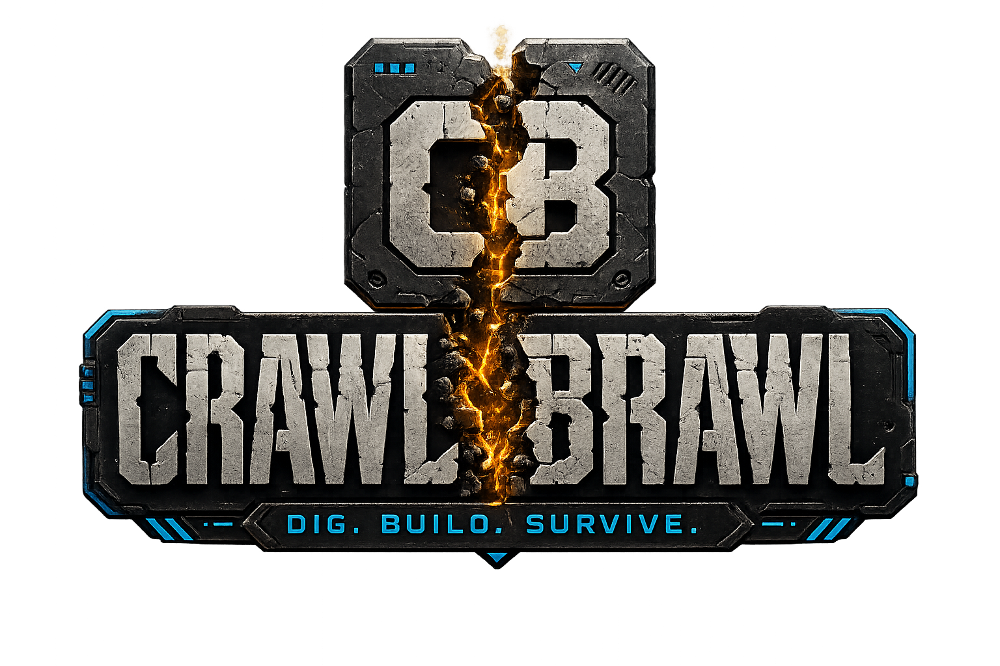
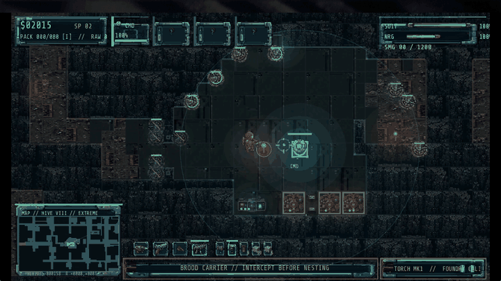
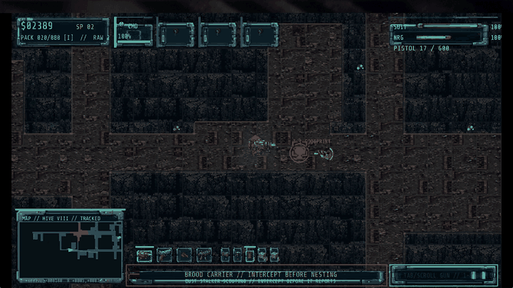
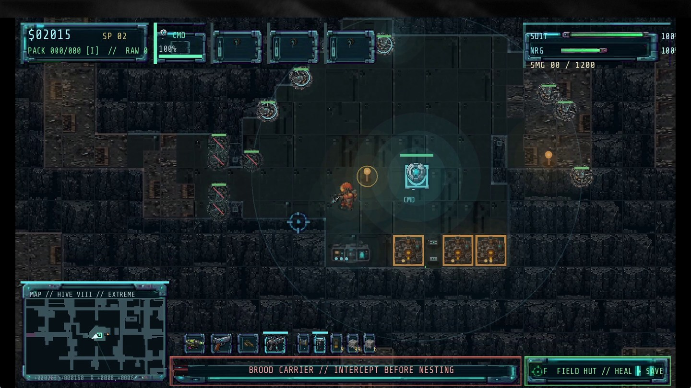
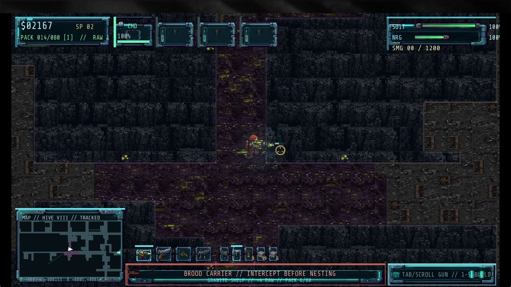
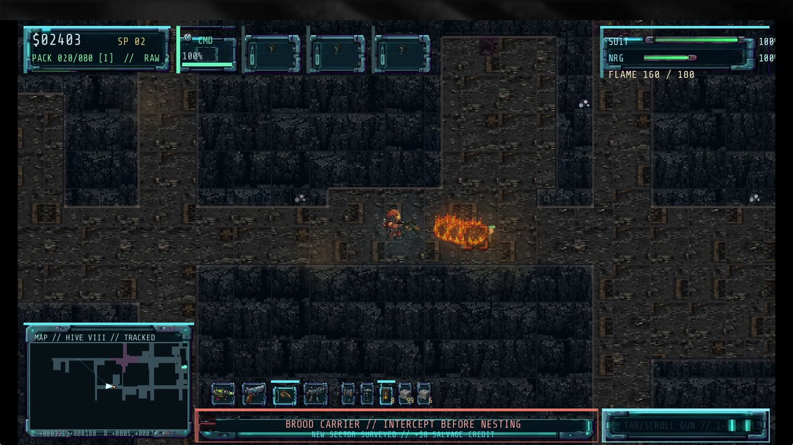

# CRAWL BRAWL

<strong>TOP-DOWN PIXEL-ACTION FORTRESS SHOOTER</strong> 
Dig through the quarantine. Shape the swarm's route. Keep the Security Core alive.

  <a href="https://github.com/RawPowered/Crawl-Brawl/releases/latest">DOWNLOAD THE WINDOWS BETA</a> &nbsp;·&nbsp;
  <a href="GAME_PLAN.md">GAME AND PRODUCTION PLAN</a> &nbsp;·&nbsp;
  <a href="CHANGELOG.md">DEVELOPMENT HISTORY</a>

---

## The game

Crawl Brawl is a top-down pixel-action fortress game set entirely underground. Play as a maintenance engineer in a quarantined complex, dig through tunnels, gather materials, build defenses, and fight the mutant spider swarms and infected humans pressing toward the Security Core.

Digging changes the battlefield. Open a direct route for resources and you may also give the hive a way into the base. Build choke points, support your defenses, and step into the fight yourself when a tunnel breaks.

**Dig. Build. Survive.**

## Gameplay in motion

These captures use the August 13, 2026 gameplay build. They show the underground map, the expanded loadout, a brood-carrier warning, and a weapon response in the tunnels.

<table>
  <tr>
    <td width="50%" valign="top">
      
<strong>01 / TRACK THE BROOD CARRIER</strong>

      
      
<em>Read the facility map and act on an incoming brood-carrier warning.</em>

    </td>
    <td width="50%" valign="top">
      
<strong>02 / HOLD THE TUNNELS</strong>

      
      
<em>Switch weapons and meet the threat inside the underground network.</em>

    </td>
  </tr>
</table>

<strong>LATEST GAMEPLAY CAPTURE / AUGUST 13, 2026</strong> Footage from an active development build. Systems and presentation may change.

<table>
  <tr>
    <td width="33%" valign="top">
<strong>COMMAND POST</strong> The core and its defenders under threat.
</td>
    <td width="33%" valign="top">
<strong>UNDERGROUND ROUTES</strong> Navigate the connected tunnel network.
</td>
    <td width="33%" valign="top">
<strong>WEAPON RESPONSE</strong> Use the loadout to meet a tunnel threat.
</td>
  </tr>
</table>

## Playable Windows package

The latest release contains a standalone Windows build. Godot does not need to be installed to play.

1. Download the Windows ZIP from [Releases](https://github.com/RawPowered/Crawl-Brawl/releases/latest).
2. Extract the ZIP to a writable folder.
3. Run `CrawlBrawl_Beta_0.1.exe`.

Beta 0.1 includes portable realm saves, recovery backups, and the latest included underground combat, excavation, fortress, economy, and brood ecology work. It is a development build for evaluation. Final release validation remains open.

See [README_PLAYER.txt](README_PLAYER.txt) for save locations and migration information. Saves are stored under `%APPDATA%\Crawl Brawl\saves` on Windows.

## From the underground to Civilian 66

Crawl Brawl was the first game in this creative direction. Its playable story stays underground. When I had found the setting and understood the direction I wanted to take, I stopped expanding the story here and carried that work into Civilian 66. Civilian 66 develops the journey beyond the underground, including how the player reaches the surface and what the above-ground story becomes.

The two projects show different stages of the same design journey. Crawl Brawl is the underground fortress game. Civilian 66 takes the story farther into exploration, first contact, and a changed world.

<a href="https://github.com/RawPowered/Civilian66-Public"><strong>EXPLORE THE CIVILIAN 66 SHOWCASE →</strong></a>

## Build from source

- Engine: Godot 4.7.1 stable
- Language: GDScript
- Main scene: `scenes/main.tscn`
- Windows build: run `Build Windows Beta.bat` with Godot 4.7.1 available. The script prepares export templates when needed, imports project resources, builds the standalone game, and packages player instructions and third-party notices.

The repository includes the Godot project, gameplay source, runtime assets, build instructions, and focused development tests. Generated caches, local saves, video-editing material, and previous builds are excluded.

## Project notes

- Single-player, offline-first design.
- Underground quarantine facility and hive setting.
- Tunneling, resource gathering, fortress construction, personal combat, and persistent realm progression.
- Current milestone: Beta 0.1 Windows distribution candidate.

The full campaign is not represented by this build. Crawl Brawl remains an underground game; the above-ground continuation belongs to Civilian 66.

## Credits and permissions

Crawl Brawl's game code, characters, and original artwork are project materials. This repository does not grant a separate license to reuse those materials. Third-party software and font notices are in [LICENSES.md](LICENSES.md); the Share Tech Mono font license is also included at [assets/fonts/OFL.txt](assets/fonts/OFL.txt).
